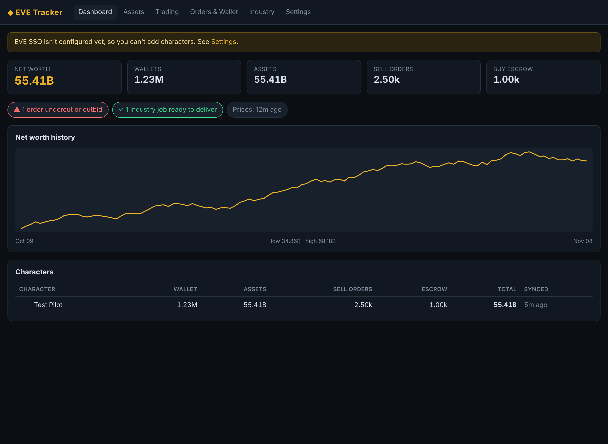
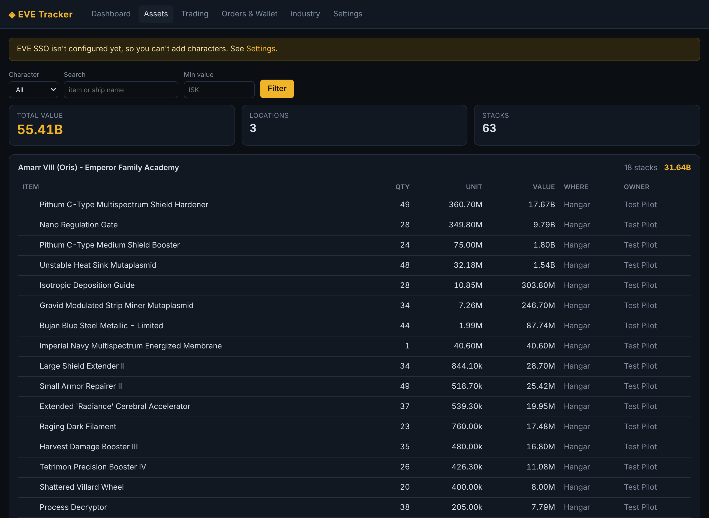
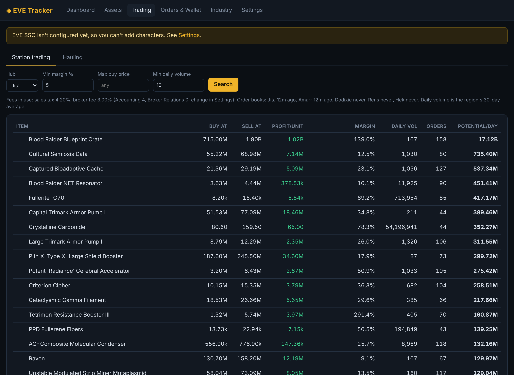
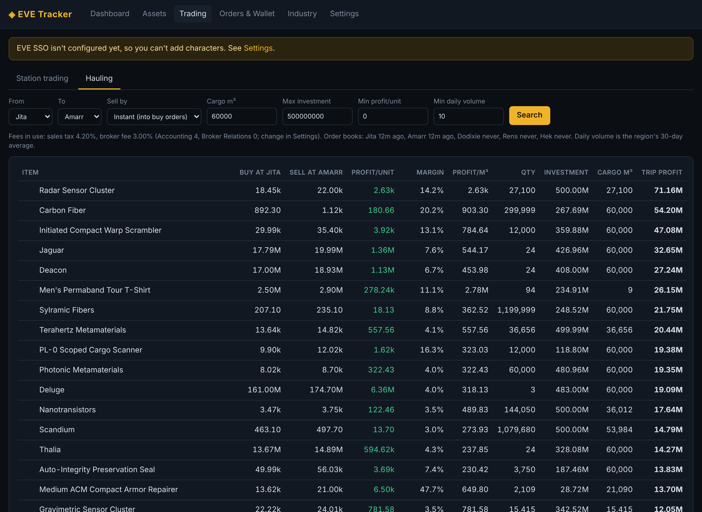
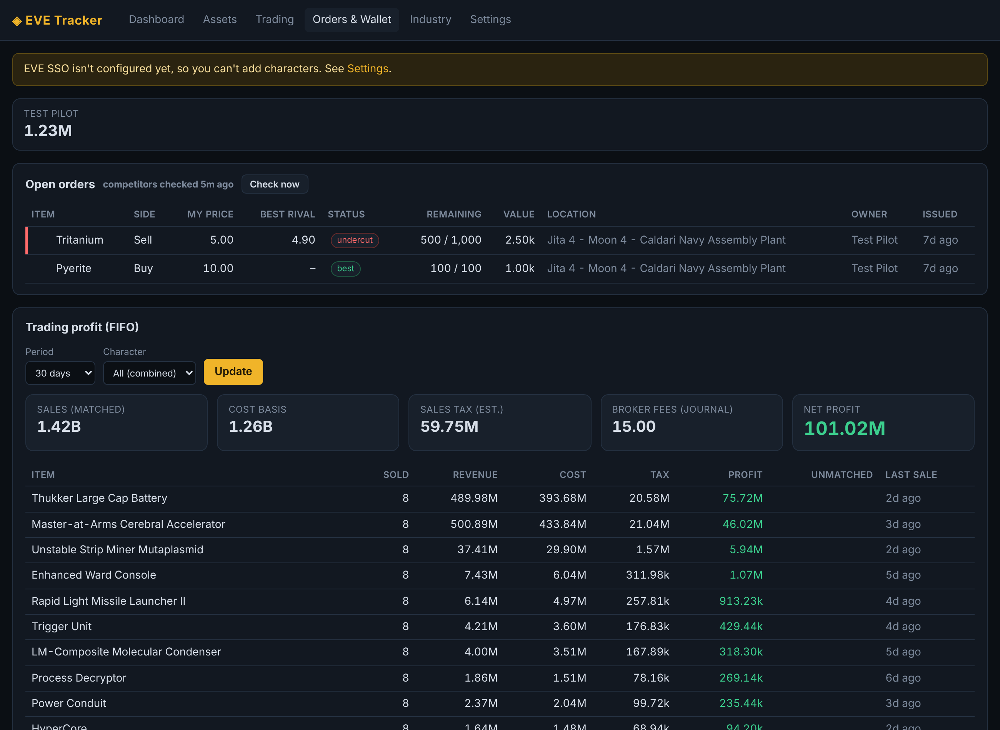
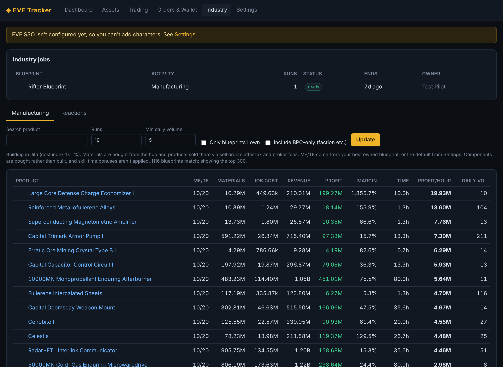
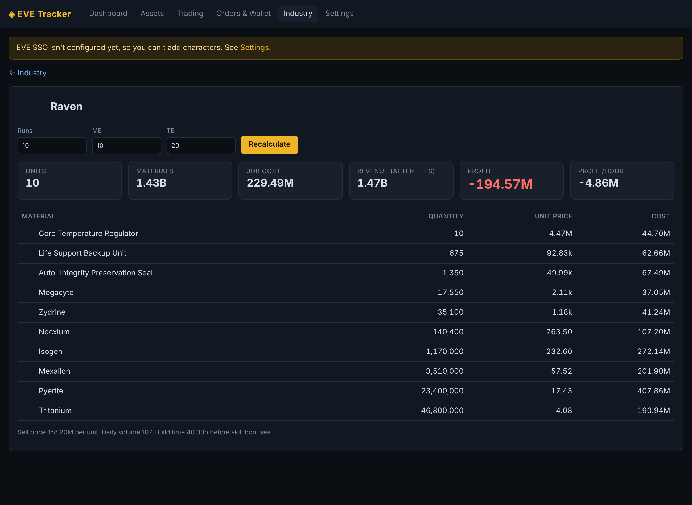
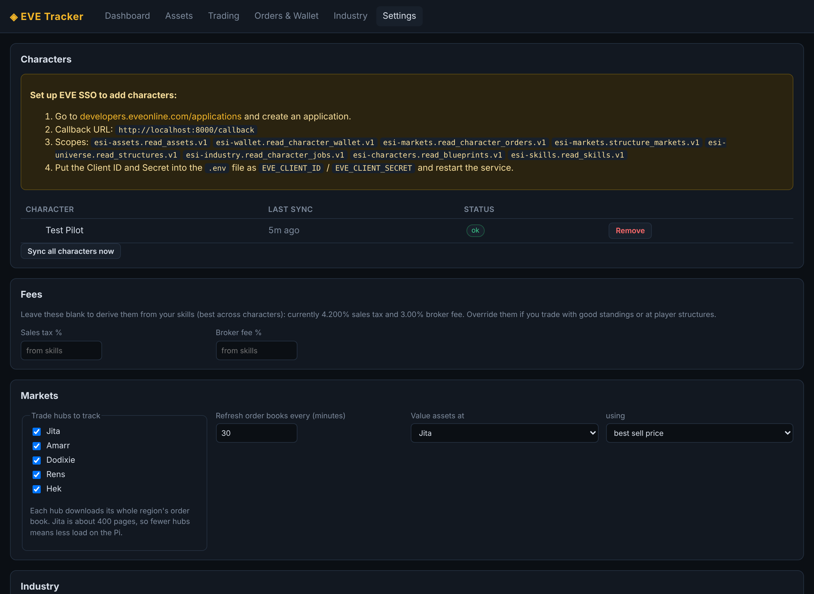
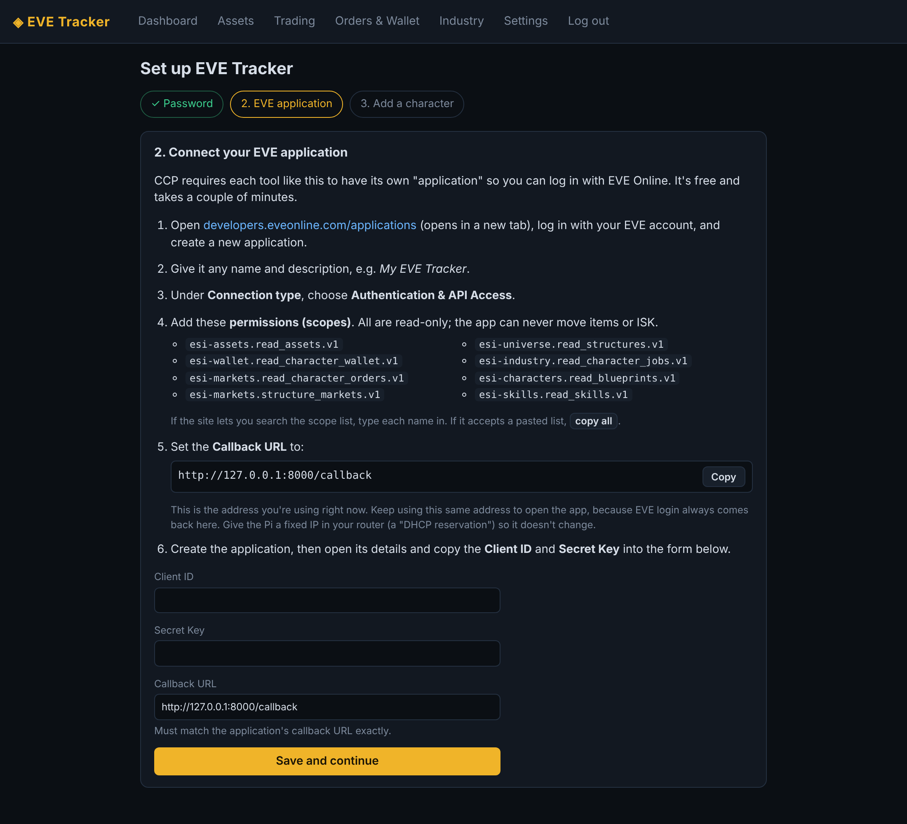

# EVE Tracker

A self-hosted EVE Online asset tracker and trading tool, built to run on a Raspberry Pi.

- **Assets & net worth:** every item across all your characters, grouped by station/structure, with ships and containers resolved and everything valued at hub prices. Hourly net-worth history.
- **Corporations:** your characters' corporations are picked up automatically. Corp hangars (with your division names), all 7 wallet divisions, transactions, market orders, industry jobs and blueprints are merged into every page, with a filter for each character or corp. Each kind of corp data needs the matching in-game role (Director sees everything), and Settings shows exactly what each corp can access and why.
- **Trade finder:** station-trading margins at Jita, Amarr, Dodixie, Rens and Hek, and hauling routes between them (instant-sell or listing), all after taxes and broker fees and filtered by real 30-day volume.
- **Orders & wallet:** your open orders with undercut/outbid detection, recent transactions, and FIFO profit & loss matched across all your characters (buy on one alt, sell on another).
- **Industry:** profit and profit/hour for every manufacturing blueprint and reaction, using your owned blueprints' ME/TE, live system cost indices, the SCC surcharge, facility tax and structure bonuses. Shows your running jobs and which ones are ready.



<details><summary>More screenshots</summary>









</details>

_Screenshots use live market data and a demo character._

- **Assets tree:** browse like the in-game inventory: station → owner → corp hangar divisions → ships (by slot: high, mid, low, rigs, cargo, drones) and containers, with values rolled up at every level, search-as-you-type, market vs quick-sale totals and thin-market warnings.
- **Map:** a zoomable map of New Eden showing where your characters are (live: system, docked or in space, ship, online), where your corp members are (member tracking, needs Director), plus asset value per system and your structures.
- **Themes:** Dark, Light, Caldari, Amarr, Gallente and Minmatar, chosen per device.
- **Contracts:** item-exchange and courier contracts for characters and corporations, with each contract's item value compared against its price.
- **Alerts on the Dashboard:** undercut orders, structure fuel and reinforcement, skill queues running out, contracts about to expire, finished industry jobs and Pi health problems.
- **Repricing helper:** each undercut order shows the closest valid price to beat (EVE allows at most 4 significant digits), ready to copy.
- **Open in EVE:** ⧉ buttons open an item's market window in your running EVE client, and ⌖ sets the autopilot destination.
- **System page:** Pi temperature, memory, SD-card space, database size and background jobs, with daily cleanup.
- **CSV export:** every table has a ⬇ CSV button.

It's a single Python process (FastAPI + SQLite) with a built-in background scheduler, so no Redis, Postgres or Docker is needed.

## Requirements

- Raspberry Pi 3B+ or newer, on 64-bit Raspberry Pi OS (Bookworm). The app uses about 60–200 MB of RAM, and the systemd service caps its memory and CPU so the Pi stays responsive. Jita and Amarr are tracked by default (about 0.5 GB/day of compressed downloads); enable Dodixie, Rens and Hek in Settings if your Pi has room. On a Pi 3 the first start takes 10–20 minutes.
- Python 3.10+ (Bookworm ships 3.11).
- Roughly 300 MB of disk for the database.

## Install on the Pi

SSH into the Pi and run:

```bash
sudo apt install -y git python3-venv
git clone https://github.com/ebilpirate-gif/eve-tracker.git
cd eve-tracker
./deploy/install.sh
```

The installer sets everything up as a service that starts on boot, then prints the address to open, e.g. `http://192.168.0.132:8000`. Open it in a browser on any device on your network and the **setup wizard** walks you through:

1. **Choosing a password** for the web UI.
2. **Connecting an EVE application.** CCP requires every tool like this to have its own (free) application at <https://developers.eveonline.com/applications>. The wizard shows the exact callback URL and permissions to enter, with copy buttons, and you paste the Client ID and Secret Key back into it.
3. **Adding your characters** via EVE's normal login page.



The first data download takes 10–20 minutes on a Pi 3. Everything can be changed later under **Settings**: characters, EVE application, password, hubs, fees and industry options.

Tip: give the Pi a fixed IP in your router ("DHCP reservation"). EVE's login always returns to the callback address you registered, so it mustn't change.

Useful commands:

```bash
journalctl -u eve-tracker -f      # live logs
sudo systemctl restart eve-tracker
```

To update: `cd ~/eve-tracker && git pull && ./deploy/install.sh`.

An optional `.env` file (see `.env.example`) can override the web settings, e.g. for scripted installs.

### Running without systemd (development)

```bash
python3 -m venv .venv && .venv/bin/pip install -r requirements.txt
.venv/bin/uvicorn evetracker.web:app --port 8000
```

Run the tests with `.venv/bin/pip install pytest && .venv/bin/python -m pytest tests`.

## Security notes

- The setup wizard requires a password before anything else. Until one is chosen, whoever opens the app first can set it, so finish setup right after installing.
- Don't port-forward the app to the internet. For access away from home, use a VPN such as Tailscale or WireGuard.
- Your EVE refresh tokens live in `data/evetracker.db`. The app can only *read* data (every scope is read-only), but keep the file private. Removing a character in Settings deletes its tokens and data, and you can revoke access at any time at <https://community.eveonline.com/support/third-party-applications/>.

## How the numbers are calculated

- **Fees:** sales tax = 7.5% × (1 − 11% × Accounting level), broker fee = 3% − 0.3% × Broker Relations level, using the best skills across your characters. Override both in Settings if you have standings or trade in player structures.
- **Asset value:** best sell (or buy) price at your valuation hub, falling back to CCP's average price. Blueprint copies count as zero.
- **Station trading:** buy via a buy order at the best bid and sell via a sell order at the best ask, both paying broker fees, and the sale pays tax. "Potential/day" assumes you capture 10% of the daily volume.
- **Hauling:** buy from sell orders at the source. "Instant" sells into the destination's buy orders, while "listing" places sell orders there.
- **Industry:** materials = max(runs, ⌈base × runs × (1 − ME) × (1 − structure bonus)⌉). Job cost = EIV × (system cost index + facility tax + 4% SCC). By default it only lists blueprints you can actually buy (BPOs) or already own, and products that trade at least 5 units a day.
- **P&L:** FIFO across all your characters. Sales with no recorded purchase (loot, manufactured goods, stock bought before you added the character) are shown as "unmatched" and left out of profit. ESI only exposes about the last 30 days of transactions, so the history builds up from the day you install the app.

## Roadmap

Ideas for later: a "by item" assets view and category filters, a daily "what changed" asset report, phone/Discord push alerts, routes and jump counts on the map, invention / T2 build chains.

## Limitations / ideas for later

- Invention / T2 manufacturing chains and building components yourself.
- Player-structure markets (e.g. Perimeter Keepstar) as trade hubs.
- Discord/push notifications for undercuts and finished jobs.
